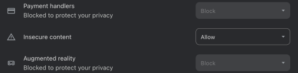
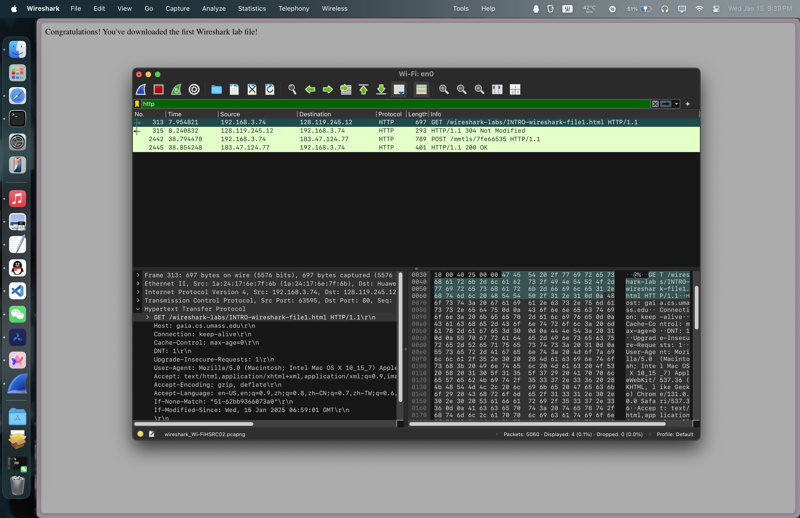

## [Getting Started](https://www-net.cs.umass.edu/wireshark-labs/Wireshark_Intro_v8.0.pdf)
- 进入[此网站](https://www.wireshark.org/download.html)选择适当操作系统与架构，下载安装 Wireshark（安装时记得chmodbpf和本体都要各运行一遍，以免后续出现意外）。
- 运行 Wireshark 和浏览器；参考[此教程](https://techysnoop.com/disable-quic-protocol-in-chrome-edge-firefox/)关闭浏览器的QUIC（若链接失效请自行搜寻）。  
***切忌使用VPN或其他类似工具！这会导致你的实验难度增加！暂时关闭是OK的，你可于实验后再打开~***
- 访问 http://gaia.cs.umass.edu/wireshark-labs/INTRO-wireshark-file1.html  
打开Wireshark并筛选“http”关键词。若浏览器自行跳转到https网站，或Wireshark内捕获不到http请求，在网站设置内将“不安全内容”设置为“允许”（如下图）。

- 正常情况下你将得到：


### 思考题
1. List 3 different protocols that appear in the protocol column in the unfiltered
packet-listing window in step 7 above. 
- DNS, QUIC, TCP 

2. How long did it take from when the HTTP GET message was sent until the HTTP
OK reply was received?   
- 21:38:45.936737(GET) ~ 21:39:16.836164(OK), 30.899427s total.

3. What is the Internet address of the gaia.cs.umass.edu (also known as www-
net.cs.umass.edu)? What is the Internet address of your computer?  
- 128.119.245.12, 192.168.3.74

4. Print the two HTTP messages (GET and OK) referred to in question 2 above.   
```bash
313	7.954821	192.168.3.74	128.119.245.12	HTTP	697	GET /wireshark-labs/INTRO-wireshark-file1.html HTTP/1.1 

2445	38.854248	183.47.124.77	192.168.3.74	HTTP	401	HTTP/1.1 200 OK 
```
