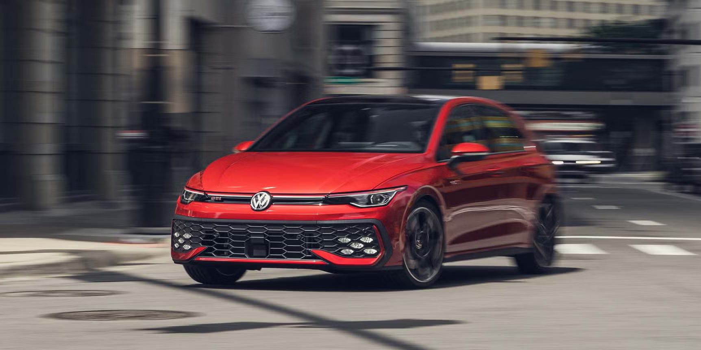
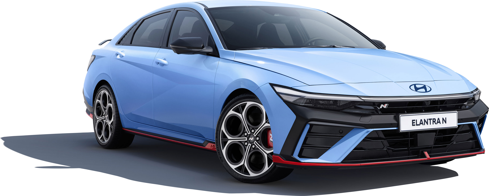
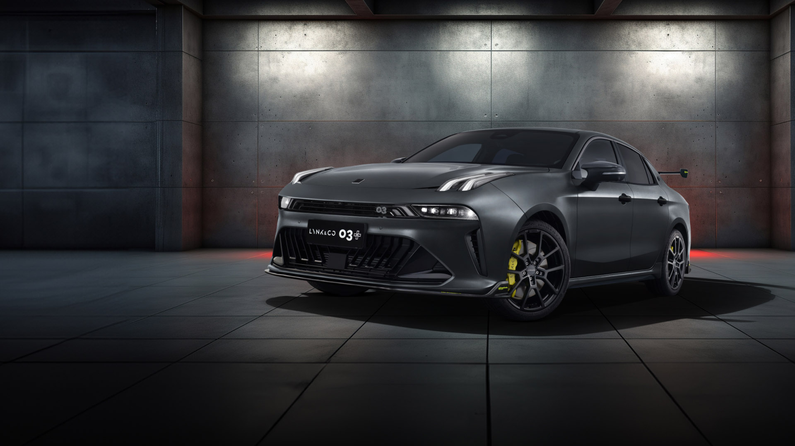
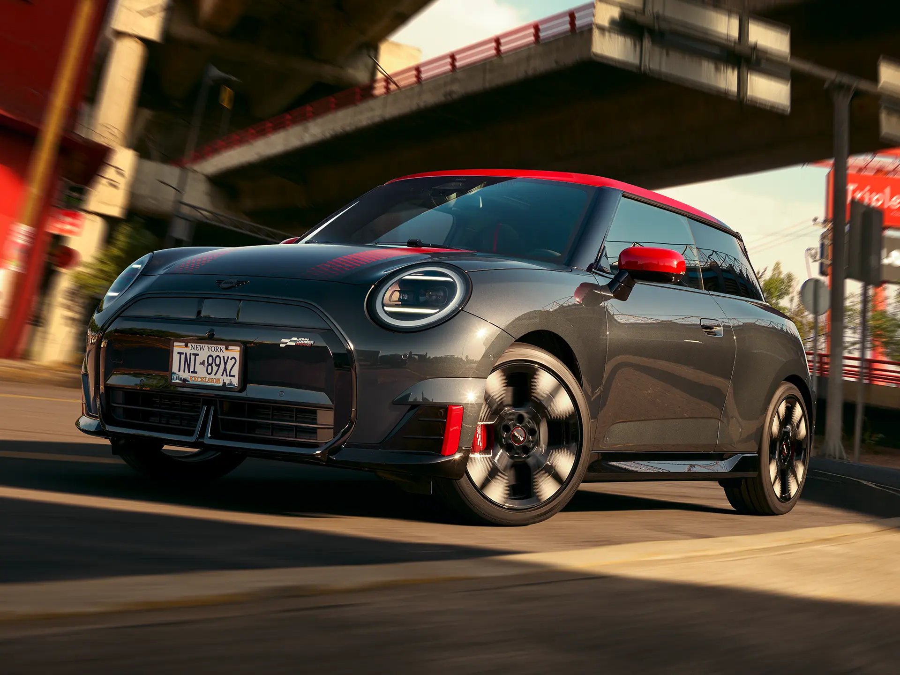
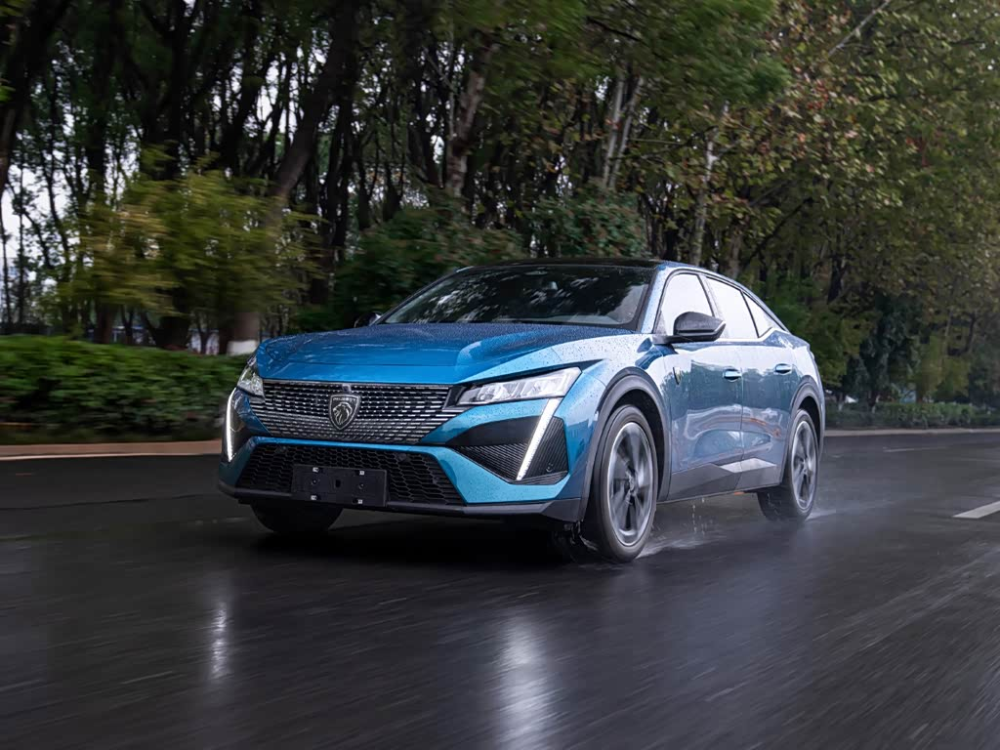
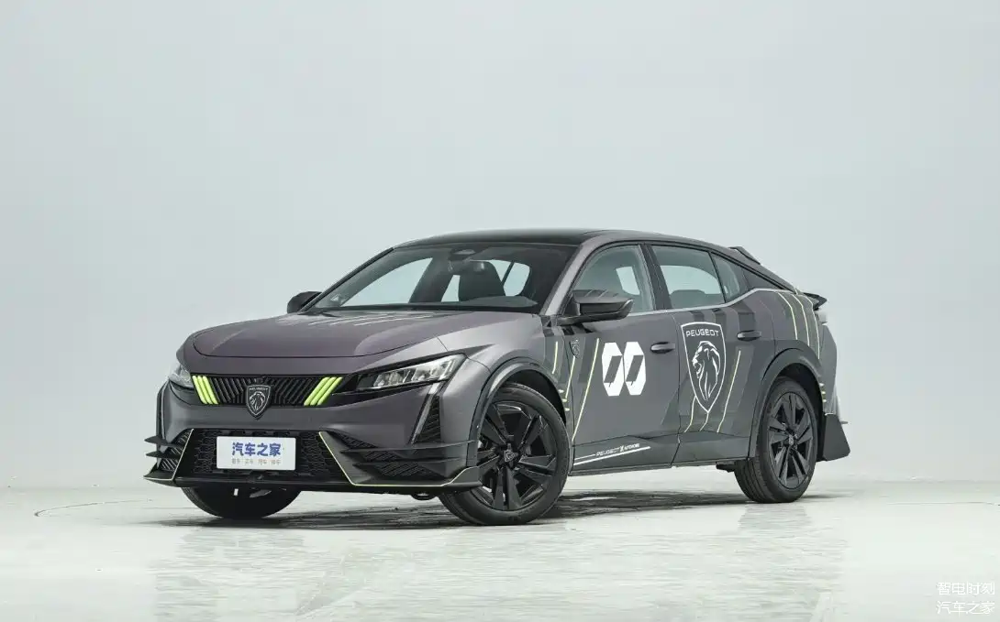
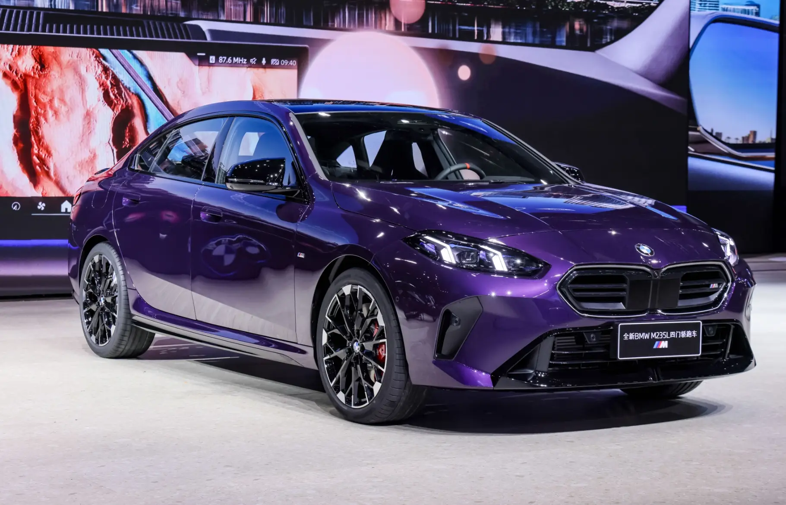
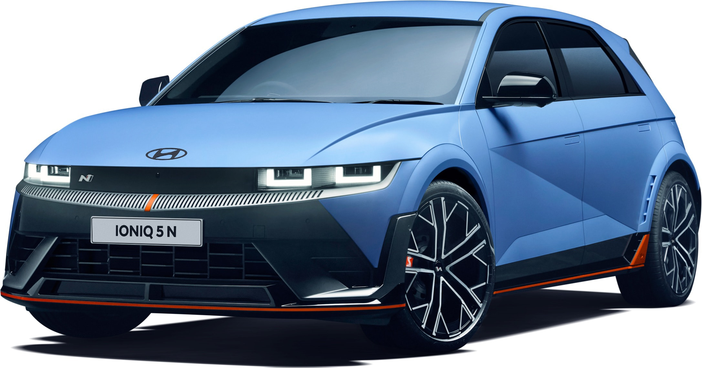
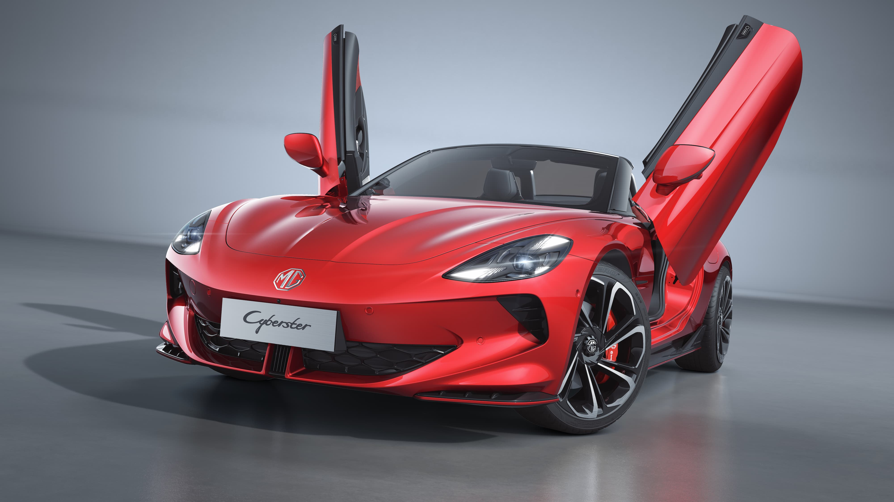

|nude| 车型  | 优点  | 缺点  | 备注  | 价格  |
|---|---|---|---|---|---|
|| ***大众 Golf GTI***  | 改装潜力，转向机  | 方向盘，变速箱  | 到手改VAQ？GPF、动力总成延保  | 20.99  |
|| ***现代 ELANTRA N***  | LSD，散热  | 油箱47L  | 刷油品学习？套件6w8  | 24.88  |
|| 领克 03+ Racing  | 双涡轮  | 110+kph车身共振  | 吉利  | 28.88  |
|| Mini JCW 三门  | 操控，车体  | 空间  | -  | 31.08  |
|| 标致 408X GT  | 内饰，i-Cockpit  | 175hp  | 勒芒套件可备案否？  | 17.97  |
|| BMW M235L  | 四驱  | 机舱橡胶件易损  | 原厂轮胎拖后腿  | 29.80  |
|| 现代 IONIQ N EV  | 驾驶乐趣  | SUV尺寸  | 电家用  | 41.30  |
|| 名爵 Cyberster  | Scissor  | 车型  | 电自享  | 31.98  |
